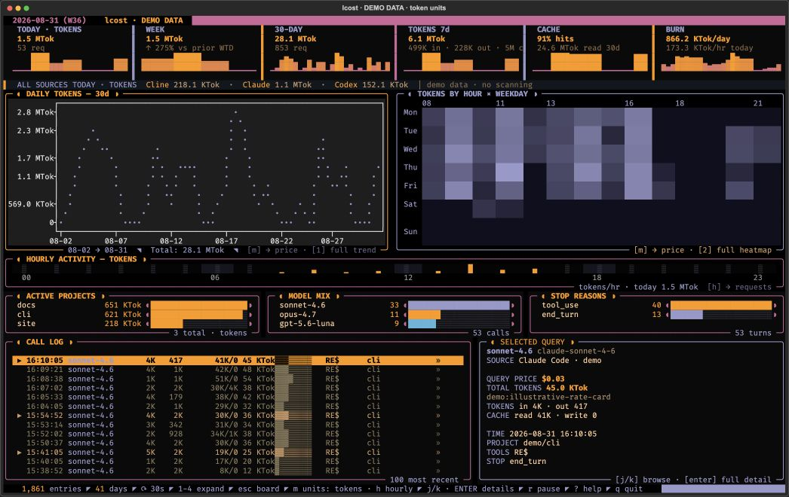

# lcost

lcost shows token usage and query costs from local Claude Code, Cline, and
Codex sessions. It combines their records in a ledger, with a terminal
dashboard for comparing projects, models, and periods of activity.



The dashboard with synthetic data for a sample Monday afternoon. Press `m`
to switch the board between price and tokens; the selected query shows both.

## Install and try the demo

Requires Python 3.9 or later on macOS or Linux. Dashboard dependencies install
with the package. A [Nerd Font](https://www.nerdfonts.com/) provides the full
set of terminal glyphs.

```bash
git clone https://github.com/brfid/lcost.git
cd lcost
python3 -m venv .venv
source .venv/bin/activate
pip install -e .
lcost --demo
```

The demo supplies 60 days of sample history, with calls grouped into tasks,
breaks, quiet nights, and lighter weekends. Today's calls appear as their
scheduled times pass, so today can be empty before work or on a day off.
Demo mode neither scans personal sessions nor reads or writes your ledger.

## Track your usage

Run `lcost` to open the dashboard with your local session history. The
collectors read files written by Claude Code, Cline, and Codex, including
supported editor integrations. They leave those source files unchanged.

```bash
lcost
lcost --report
```

The text report defaults to the last 30 days with activity. Use
`lcost --demo --report` to print a report from the sample history.

Source and project filters work in both modes:

```bash
lcost --source codex
lcost --source claude-code
lcost --source cline --project techdocs
lcost --report --days 7
lcost --report --from 2026-04-01 --to 2026-04-30
```

`--project` matches a case-insensitive substring of the stored project path.
Date bounds are inclusive. `--days N` selects calendar days in the dashboard
and active days in reports; see [date filtering](docs/reference.md#date-filtering)
for the defaults and interaction with other options. `lcost --help` lists
all command-line options.

## Read the dashboard

The board puts period summaries beside recent activity:

| Panel | Contents |
| --- | --- |
| Summary strip | Today, week to date, 30 days, token usage, cache efficiency, and daily/hourly usage rates |
| Daily trend | Usage over 30 calendar days by default, including idle days |
| Heatmap | Usage by hour and weekday; the hour range fits the selected data, retaining gaps between active hours |
| Hourly activity | Today's usage across the full 24 hours |
| Rankings | Today's leading projects, model mix, and stop reasons |
| Call log | The 100 most recent queries, with a price and token breakdown for the selected query |

On the board, `m` switches summaries, charts, project rankings, and call-log
values between price and total tokens. In token mode, the cache summary
shows the share of input served from cache. Query details always show both
units and the separate input, output, and cache buckets.

The heatmap uses the same hour range across units in both views. With no
activity, it shows the full day. The `h` key changes the hourly bar's metric
independently; the next board unit change brings it back into the board's
units.

The source strip shows today's usage and the age of each source's last
successful scan. The dashboard refreshes every 30 seconds. New queries have
a `★` marker, and subagent calls have `↳`. The status bar shows the current
filters, units, entry count, and refresh state. In smaller terminals, the
board hides charts or the query inspector to leave room for the call log.

### Expand a panel

| Key | Panel | Metric control |
| --- | --- | --- |
| `1` | TREND | `m` cycles price, input/output tokens, cache tokens, and savings |
| `2` | HEATMAP | `m` cycles price, requests, and tokens |
| `3` | LOG | Uses the board's selected units |
| `4` | CALLS | Per-query price distribution |

### Controls

| Key | Action |
| --- | --- |
| `m` | Switch board units or cycle the expanded panel's metric, as listed above |
| `h` | Cycle the board's hourly bar through price, tokens, and requests |
| `0` | Return to the board |
| `Esc` | Close an open detail or help view, or return to the board |
| `]` / `[` | Next / previous expanded panel |
| `j` / `k` | Move down / up one query in the call log; scroll other panels |
| `J` / `K`, `Ctrl+d` / `Ctrl+u` | Move down / up ten queries, or scroll ten lines in other panels |
| `g` / `G` | First / last query, or top / bottom of the current panel |
| `Enter` | Open the selected query's details |
| `r` | Pause / resume automatic refresh |
| `?` | Show help for the current view |
| `q` / `Ctrl+c` | Quit |

## Understand the numbers

Cline supplies per-query costs in its session records. Claude Code and
Codex costs are estimates calculated from token counts and configured model
rates. These estimates do not allocate subscription fees or reproduce an
account invoice. See [tokens and pricing](docs/reference.md#tokens-and-pricing)
for the accounting rules and rate sources.

The ledger retains ingested usage after source sessions are deleted. Repeated
scans deduplicate entries and apply supported corrections. See the
[reference](docs/reference.md) for scanning, recovery, cost recalculation,
and stored data.

## Development

Install the commit hook to keep runtime usage files out of Git, then install
the test dependencies and run the suite:

```bash
./scripts/install-hooks.sh
pip install -e '.[test]'
python -m pytest -q
```

Tests use synthetic sessions and temporary ledgers. The
[CI workflow](.github/workflows/guard.yml) defines the tested Python versions
and platforms. The [module guide](docs/reference.md#module-responsibilities)
identifies where collection, storage, calculations, and presentation belong.
